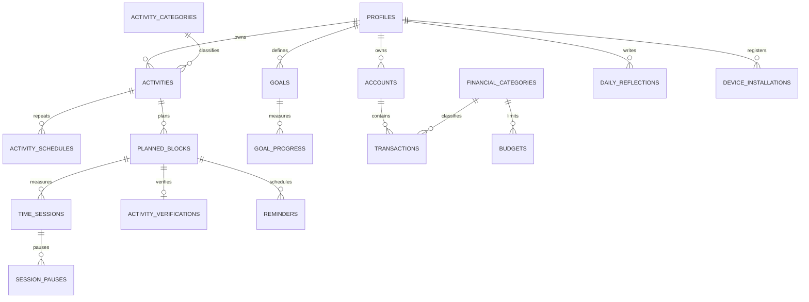

# Modelo de datos

## Reglas importantes

- Una actividad es una plantilla; un bloque es una ocurrencia planificada.
- Una sesión registra realidad y puede existir sin bloque para tiempo espontáneo.
- Sólo puede existir una sesión abierta por usuario.
- Cada bloque admite una verificación final.
- Los solapamientos se informan mediante `v_schedule_conflicts`; no se bloquean.
- Los importes son positivos y `kind` expresa su dirección.
- Los movimientos bloqueados se corrigen mediante reversión.
- `deleted_at` permite sincronizar eliminaciones de forma segura.
